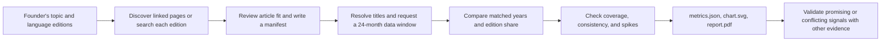

# Wikipedia Interest Skill

A standalone [Agent Skills](https://agentskills.io/specification) package for comparing interest in topics across Wikipedia language editions. The TypeScript CLI collects monthly pageviews, checks whether a trend is broad or concentrated in a few months, and writes an SVG chart and a one-page PDF. It helps a B2C team choose **questions to validate next**; article views do not measure customers or willingness to pay.

The agent-facing instructions are in [SKILL.md](SKILL.md). This README explains the workflow and how to run the project directly.

## Workflow logic



1. **Choose comparable article proxies.** `discover` finds titles linked across editions; `search` helps when a link is missing. A person checks whether each page represents the intended topic, records exact titles and a rationale in a JSON manifest, and notes limitations. An absent page is not evidence of absent interest.
2. **Collect traceable data.** `analyze` resolves current canonical titles and retrieves monthly article views plus total edition traffic from Wikimedia's Pageviews API (`all-access`, `user`). Requests are sequential, retry transient failures, and use a disk cache. The output records source URLs, response status, retrieval time, and cache use.
3. **Compare like periods.** The default 24-month window ends at the prior UTC month, or two months back on UTC days 1–2 to allow for publication lag. It compares 12 recent months with the same 12 calendar months a year earlier. The CLI calculates raw view change and the article's share per million edition views, so growth can be read alongside changes in the edition's overall traffic. It also counts how many matched months rose or fell and checks whether one month dominates either year.
4. **Guard against incomplete or fragile signals.** Missing article months count as zero only where edition traffic confirms that month exists. Missing edition months, or no article observations, make complete-window growth unavailable. A high, medium, low, or insufficient reliability label is a documented heuristic based on coverage, volume, matched-month consistency, and peak concentration; it is not statistical confidence. A configurable screening rule identifies leads for further investigation.
5. **Report and refine.** `metrics.json` holds exact values and provenance; `chart.svg` shows indexed trends; `report.pdf` summarizes the result on one page. The agent should report the chosen proxies, period, raw and relative trends, contrary evidence, and a concrete validation step. Follow-up questions can change the manifest, screening criteria, or end month while reusing the cache.

Wikipedia editions are language audiences, not country populations. Different articles can cover different concepts, and multiple selected pages can include overlapping readers. The PDF's screening result is a research lead, not a launch decision.

## Run it

Requires Node.js 20 or newer. Dependencies are pinned in `package-lock.json`; `tsx` runs the TypeScript source without a build step.

```sh
npm ci
export WIKIMEDIA_USER_AGENT='WikipediaInterest/1.0 (your-real-contact@example.com)'
node --import tsx scripts/wiki-interest.ts discover --source en:Astronomy --languages uk,pl,cs
node --import tsx scripts/wiki-interest.ts search --language pl --query "astronomia"
node --import tsx scripts/wiki-interest.ts analyze --manifest examples/astronomy.json --out /tmp/astronomy-interest
```

Use a real operator contact in `WIKIMEDIA_USER_AGENT` for live requests. `analyze` writes `metrics.json`, `chart.svg`, and `report.pdf` in the output directory. Use `--end YYYY-MM` for a historical comparison, `--cache DIR` to share cached API responses across runs, and `--refresh` to recheck data. Run `node --import tsx scripts/wiki-interest.ts --help` for all options.

[The example manifest](examples/astronomy.json) compares broad astronomy articles in Ukrainian, Polish, and Czech. [A saved Ukrainian run](examples/astronomy-output/metrics.json) includes its [chart](examples/astronomy-output/chart.svg) and [PDF](examples/astronomy-output/report.pdf); it is a point-in-time example, not a current market recommendation.

## Code and verification

| Path | Role |
| --- | --- |
| [`scripts/wiki-interest.ts`](scripts/wiki-interest.ts) | CLI commands and options |
| [`scripts/client.ts`](scripts/client.ts) | Wikimedia requests, retries, cache, and source tracking |
| [`scripts/pipeline.ts`](scripts/pipeline.ts) | Title resolution and data collection workflow |
| [`scripts/core.ts`](scripts/core.ts) | Manifest validation, matched-year metrics, reliability, and screening |
| [`scripts/report.ts`](scripts/report.ts) | SVG chart and PDF rendering |
| [`tests/`](tests/) | Unit and integration coverage |

Run `npm run typecheck` and `npm test` after changes. [Validation notes](references/validation.md) record the API, PDF, and low-cost model workflow checks; [requirement coverage](references/requirements-validation.md) maps the deliverable to the requested criteria. [The development roadmap](references/roadmap.md) describes how to add stronger proxy checks, trend diagnostics, larger datasets, and independent market evidence. Bundled font licenses are in [`assets/`](assets/).
