# Wikipedia Interest Skill

A standalone [Agent Skills](https://agentskills.io/specification) package for comparing interest in topics across Wikipedia language editions. The TypeScript CLI collects monthly pageviews, checks whether a trend is broad or concentrated in a few months, and writes an SVG chart and a one-page PDF. It helps a B2C team choose **questions to validate next**; article views do not measure customers or willingness to pay.

The agent-facing instructions are in [SKILL.md](SKILL.md). This README explains the workflow and how to run the project directly.

## Give it to another agent

Share this repository or the source ZIP, then place the **whole** `wikipedia-interest` directory in a skill location that the person's agent scans. Keep `SKILL.md`, `scripts/`, `assets/`, `package.json`, and `package-lock.json` together; copying only `SKILL.md` leaves out the analysis code.

For a local Codex agent, install the ZIP under `~/.agents/skills/`; for Claude Code, use `~/.claude/skills/` instead. Those are the [Codex](https://learn.chatgpt.com/docs/build-skills) and [Claude Code](https://code.claude.com/docs/en/skills) personal skill locations. For example, with Codex:

```sh
mkdir -p ~/.agents/skills
unzip wikipedia-interest-skill.zip -d ~/.agents/skills
cd ~/.agents/skills/wikipedia-interest
npm ci
```

To install from GitHub once the repository is published, clone it directly to `~/.agents/skills/wikipedia-interest` (or `~/.claude/skills/wikipedia-interest`), then run `npm ci` there. The agent needs shell access to run Node.js 20+ and network access to Wikimedia for fresh data. Set `WIKIMEDIA_USER_AGENT` with a real operator contact in the agent's environment, or have the agent pass `--user-agent` for live requests. Restart the agent if the skill does not appear.

Then ask, for example: “Use `$wikipedia-interest` to compare interest in intermittent fasting on Polish and Czech Wikipedia over the latest 24 months. Check that the selected articles cover comparable topics, create the chart and one-page PDF, and explain raw growth, edition-relative growth, signal quality, and limitations.” In Claude Code, invoke `/wikipedia-interest` instead. A matching natural-language request can also activate the skill automatically. Agents without built-in skill discovery can be given the folder and told to read `SKILL.md` and run the bundled CLI.

## Workflow logic

```mermaid
flowchart LR
    A[Founder's topic and language editions] --> B[Discover linked pages or search each edition]
    B --> C[Review article fit and write a manifest]
    C --> D[Check concept IDs and known page moves]
    D --> I[Request one title for each full month]
    I --> E[Compare matched years and edition share]
    E --> F[Check coverage and remove the largest matched month pair]
    F --> G[metrics.json, chart.svg, report.pdf]
    G --> H[Validate promising or conflicting signals with other evidence]
```



1. **Choose comparable article proxies.** `discover` finds titles linked across editions; `search` helps when a link is missing. A person checks whether each page represents the intended topic, records exact titles and a rationale in a JSON manifest, and notes limitations. An absent page is not evidence of absent interest.
2. **Check pages and collect traceable data.** `analyze` resolves all current titles and their Wikidata concept IDs first. Different known IDs across editions stop the run until page selection is changed or the manifest explains the intentional difference. Missing IDs remain unverified. For a known former title, the move log and stable page ID determine which title to query for each full month. The month containing a move is unknown because both titles can receive views. The analysis also retrieves total edition traffic from Wikimedia's Pageviews API (`all-access`, `user`). Requests are sequential, retry transient failures, and use a disk cache. The output records source URLs, response status, retrieval time, and cache use.
3. **Compare like periods.** The default 24-month window ends at the prior UTC month, or two months back on UTC days 1–2 to allow for publication lag. It compares 12 recent months with the same 12 calendar months a year earlier. The CLI calculates raw view change and the article's share per million edition views, so growth can be read alongside changes in the edition's overall traffic. It also counts how many matched months rose or fell, checks whether one month dominates either year, and repeats the growth calculation after excluding the busiest month and its same month a year apart.
4. **Guard against incomplete or fragile signals.** A successful article response can omit zero-view months; those count as zero only where edition traffic confirms that month exists. A 404 or exhausted transient article request is unknown, so any affected edition has no complete-window growth or selected candidate. Missing edition months and no article observations have the same effect. New `metrics.json` results record `reported`, `zero`, or `unknown` for every selected article and month, plus API status and any transient request error. The existing `confidence` field is displayed as **signal quality**: a heuristic based on coverage, volume, matched-month consistency, and peak concentration. It can be high for a steady decline and does not measure demand. The default screen now requires a rising monthly direction in addition to recent volume, signal quality, raw growth, and edition-relative share growth.
5. **Report and refine.** `metrics.json` holds exact values and provenance, including each article's monthly contribution, the edition's monthly traffic, the 11-month check, each selected article's own trend, and each edition's screening reasons; `chart.svg` shows indexed trends; `report.pdf` summarizes the result on one page. The PDF names the article with the most recent views only when all selected articles have complete recent data. The agent should report the chosen proxies, period, raw and relative trends, whether one month drives the result, contrary article trends, why each edition passed or failed screening, and a concrete validation step. Follow-up questions can change the manifest, screening criteria, or end month while reusing the cache.

Wikipedia editions are language audiences, not country populations. Different articles can cover different concepts, and multiple selected pages can include overlapping readers. The PDF's screening result is a research lead, not a launch decision.

### Review concept and title history

A Wikidata ID (such as `Q918`) labels a shared concept across Wikipedia editions. Matching IDs support the page choice, but still require a person to check article scope against the question. If all selected pages have IDs and the editions have different ID sets, `analyze` stops before requesting pageviews. For an intentional comparison of different concepts, record the reason in the manifest:

```json
{
  "topic": "Example topic",
  "conceptMismatchRationale": "The selected pages cover deliberately different scopes; compare them separately in the interpretation.",
  "editions": [
    { "language": "en", "articles": ["English article"] },
    { "language": "uk", "articles": ["Ukrainian article"] }
  ]
}
```

For a page with a known older title, add `formerTitles` under that edition. Its key is the title you selected in `articles`:

```json
{
  "language": "en",
  "articles": ["X (social network)"],
  "formerTitles": { "X (social network)": ["Twitter"] }
}
```

An actual redirect from the selected title is also treated as a former-title hint. The move log must confirm that the old and new titles belonged to the same page ID. `metrics.json` records `conceptCheck`, each article's `wikidataId`, `historyStatus`, `moveEvents`, `moveLookupUrls`, `uncertainMonths`, and `trafficSegments` with the exact title, months, URL, status, and retrieval time used. The monthly count remains under the current canonical title in `articleMonthlyViews`. If a move occurs during a month, that whole month is `null`; the edition's complete growth and candidate selection are unavailable. If a move lookup fails or the title chain cannot be proved, all affected article months are unknown. With no known former title, `historyStatus` is `unchecked`: this phase does not discover every historical title.

## Read the monthly breakdown

Each entry in `results` has `articleMonthlyViews` keyed by resolved article title, `editionMonthlyViews` for all user pageviews in that language edition, and the existing `monthlyViews` for the combined selected articles. For one month, the values might be:

```json
{
  "articleMonthlyViews": { "Rising": { "2026-08": 120 }, "Falling": { "2026-08": 80 } },
  "editionMonthlyViews": { "2026-08": 2000000 },
  "monthlyViews": { "2026-08": 200 }
}
```

The combined count is `120 + 80 = 200`; its share that month is `200 / 2,000,000 × 1,000,000 = 100` selected-article views per million edition views. The existing `sharePriorPerMillion` and `shareRecentPerMillion` divide the **sum of article views over each 12-month window** by the **sum of edition views over the same window**, then multiply by one million. They are not averages of monthly shares. If any selected article or the edition has an unknown month, `monthlyViews` for that month is `null`, and complete-window growth and share are unavailable. A verified zero is `0`; `sources[].articles[].monthStatus` explains whether an article count was reported, inferred as zero, or unknown. Observed counts remain visible even when the edition month is unknown. The saved astronomy output was generated before these new fields were added.

## Understand why an edition passed or failed

The default screen applies five checks to each Wikipedia language edition:

| Check | Default requirement |
| --- | --- |
| Recent views | At least 200 views across the selected articles in the recent 12 months. |
| Signal quality | `medium` or `high`. The JSON field is still named `confidence` for compatibility. |
| Raw growth | Selected-article views increased from the preceding 12 months. |
| Share growth | Selected-article views gained share relative to all views in that edition. |
| Monthly direction | `rising`, meaning at least 8 of 12 matching months increased. |

For every edition, `results[].screeningAssessment.checks` lists the observed value, requirement, status (`pass`, `fail`, or `not-required`), and an explanation. `eligible` says whether all required checks passed. `eligibleRank` is 1 for the selected edition, 2 for the next passing edition, and `null` for a failure. A passing edition can rank below another; the order remains high signal quality first, then higher share growth, then more recent views. The top-level `nextValidationStep` suggests a user-research action. The PDF shows a short outcome for every edition and the next step; `metrics.json` has the full reasons.

The monthly rule matters when an annual increase is uneven. If the prior year had 100 article views each month and the recent year had six months at 110, five at 90, and one at 200, the annual total rises from 1,200 to 1,310 (+9.2%). Yet only seven matching months rose, so `direction` is `mixed` and the default screen fails. Set `"screening":{"requireRisingDirection":false}` in the manifest only when the research question should accept mixed monthly direction. Existing `minRecentViews`, `minConfidence`, `requireRawGrowth`, and `requireShareGrowth` overrides still work. A high signal-quality label can also describe a steady fall, so it must never be read as confidence in product demand. The selected edition is a lead for interviews or a small sign-up test, not a launch decision.

## Check whether one month drives growth

Suppose selected articles have 100 views every month in 2025 and 2026, except June 2026 has 1,100. The ordinary comparison is 1,200 to 2,200 views, or **+83.3%**. The `peakPairSensitivity` check removes June 2025 **and** June 2026, then compares the remaining 11 months in each year: 1,100 to 1,100, or **0%**. For edition-relative share, it also removes those months from the whole-edition totals before dividing. This checks whether the growth survives one unusually busy month; it does not replace the ordinary 12-month result or change `selectedCandidate`. A selected edition can still owe its lead to one event, so inspect both figures.

In `results[].peakPairSensitivity`, `peakMonth` is the largest **combined selected-article** month among the 24 months, and `excludedMonths` names the matching pair. `viewsPrior`, `viewsRecent`, `viewsYoyPct`, `sharePriorPerMillion`, `shareRecentPerMillion`, and `shareYoyPct` are the 11-month values. `rawDirectionChanged` and `shareDirectionChanged` show whether the sign of growth changed from positive to flat/negative, or vice versa. `status` is `available`, `incomplete-data`, `zero-traffic`, or `zero-baseline`; unavailable percentages are `null`, never zero. A missing article or edition month, including a page-move month, blocks this check. If the remaining prior article total is zero, the counts remain visible but growth percentages are `null`.

`results[].articleTrends` gives each selected article's prior/recent 12-month views, percentage change, and `rising`, `falling`, `flat`, or `unavailable` direction. One complete article can have a trend even if another article has an unknown month. If an article rose from zero, its direction is `rising` but its percentage is `null` because division by zero has no useful percentage. The PDF shows the 11-month raw/share change beside the ordinary 12-month measures; `*` marks a changed growth direction. It names opposing articles when space permits and points to `metrics.json` for every article and exact excluded months. The saved astronomy output predates these Phase 4 fields.

## Run it

Requires Node.js 20 or newer. Dependencies are pinned in `package-lock.json`; `tsx` runs the TypeScript source without a build step.

```sh
npm ci
export WIKIMEDIA_USER_AGENT='WikipediaInterest/1.0 (your-real-contact@example.com)'
node --import tsx scripts/wiki-interest.ts discover --source en:Astronomy --languages uk,pl,cs
node --import tsx scripts/wiki-interest.ts search --language pl --query "astronomia"
node --import tsx scripts/wiki-interest.ts analyze --manifest examples/astronomy.json --out /tmp/astronomy-interest
```

Use a real operator contact in `WIKIMEDIA_USER_AGENT` for live requests. `analyze` writes `metrics.json`, `chart.svg`, and `report.pdf` in the output directory. Use `--end YYYY-MM` for a historical comparison, `--cache DIR` to share cached API responses across runs, and `--refresh` to recheck data. Run `node --import tsx scripts/wiki-interest.ts --help` for all options.

[The example manifest](examples/astronomy.json) compares broad astronomy articles in Ukrainian, Polish, and Czech. [A saved Ukrainian run](examples/astronomy-output/metrics.json) includes its [chart](examples/astronomy-output/chart.svg) and [PDF](examples/astronomy-output/report.pdf); it is a point-in-time example, not a current market recommendation.

## Code and verification

| Path | Role |
| --- | --- |
| [`scripts/wiki-interest.ts`](scripts/wiki-interest.ts) | CLI commands and options |
| [`scripts/client.ts`](scripts/client.ts) | Wikimedia requests, retries, cache, and source tracking |
| [`scripts/pipeline.ts`](scripts/pipeline.ts) | Title resolution and data collection workflow |
| [`scripts/title-history.ts`](scripts/title-history.ts) | Verified move-chain assignment by month |
| [`scripts/core.ts`](scripts/core.ts) | Manifest validation, matched-year metrics, signal quality, and screening |
| [`scripts/diagnostics.ts`](scripts/diagnostics.ts) | Peak-month sensitivity and individual article trends |
| [`scripts/format.ts`](scripts/format.ts) | Percentage labels shared by screening explanations and reports |
| [`scripts/report.ts`](scripts/report.ts) | SVG chart and PDF rendering |
| [`tests/`](tests/) | Unit and integration coverage |

Run `npm run typecheck` and `npm test` after changes. [Validation notes](references/validation.md) record the API, PDF, and low-cost model workflow checks; [requirement coverage](references/requirements-validation.md) maps the deliverable to the requested criteria. [The development roadmap](references/roadmap.md) describes how to add stronger proxy checks, trend diagnostics, larger datasets, and independent market evidence. Bundled font licenses are in [`assets/`](assets/).
